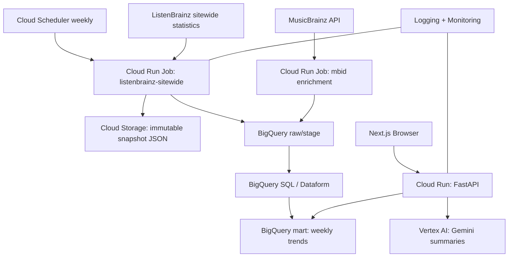

# 03 Google Cloudシステムアーキテクチャ

## 1. 構成

## 2. MVP実行フロー
1. Schedulerは週次に一度、確定した週の統計を取得（ListenBrainz側の更新タイミングを確認し、遅延を許容）。
2. 取得した`payload.from_ts`, `to_ts`, `last_updated`, `fetched_at`を検査し、**期間を固定したスナップショット**として保存。未確定/既知期間が変化した場合は版管理。
3. ListenBrainzの楽曲/アーティスト応答をCloud StorageにJSON保存し、BigQueryに正規化ロード。サイト全体上位Nのみ取り扱う。
4. MBIDが欠損していてもレコードは保持し、一意識別用のソースキーで追跡。MusicBrainzのlookupはキャッシュし、検証可能なIDだけを補完。
5. 重複・期間整合性チェック後、BigQueryで前週との変化率・急上昇スコアを計算。前週が存在しない場合はNULL。
6. FastAPIは事前集計済みマートを参照。Geminiはユーザー要求時のみ集計説明を生成。

## 3. 非重複期間の条件
最初の2週が揃うまで伸び率ランキングを出さない。APIが返す直近週がローリング窓なら、毎回の`week`取得値を独立週とみなさない。明示された`from_ts/to_ts`から比較可能性を判定し、条件に合わなければ人気ランキングのみ表示する。過去期間の自由なリクエストをsitewide stats APIが提供する前提を置かない。

## 4. 公開ダンプへ拡張する場合
ダンプはオブジェクトストレージにストリーム取得しチェックサム/マニフェスト管理。フル基点から増分を順序適用、提出時刻で高水位を管理し、listen日時で週別集計。重複排除、遅延提出、削除反映（フル再同期）を考慮。大規模なのでCloud Run Jobsの制限や転送/BigQuery処理コストを検証し、必要ならDataflowを選ぶ。**MVPでダンプ全量取込はしない。**

## 5. インフラと分離
- Cloud Run `api`, `sitewide_ingest`, `metadata_enrich`（個別サービスアカウント）
- BigQuery `raw`, `stage`, `mart`, `ops`（パーティション/クラスタ、クエリ課金上限）
- GCS `snapshots`, Cloud Scheduler, Artifact Registry, Cloud Build, Secret Manager, Logging/Monitoring
- `dev`はfixture中心、`prod`は認証必須・専用権限。Cloud Run、Vertex AI、BigQueryを同一リージョンに可能な範囲で配置し、サービス提供可否を確認。

## 6. 失敗/回復
API429/5xx時はRetry-Afterと指数バックオフ、最大試行回数。レスポンス204は空データとして判定。期間不一致/異常な件数はマート更新保留。過去の確定データを残すが、`stale=true`表示。Gemini失敗で通常ランキングは止めない。
